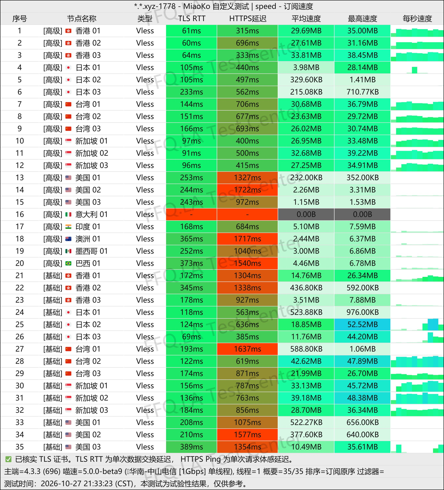
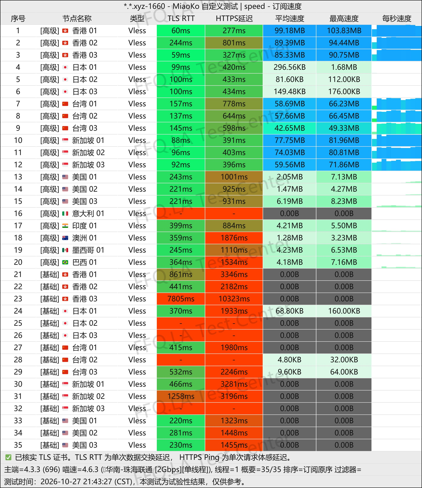
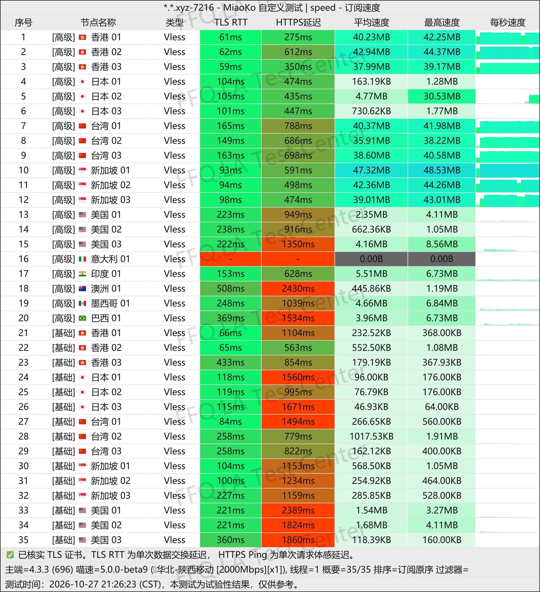
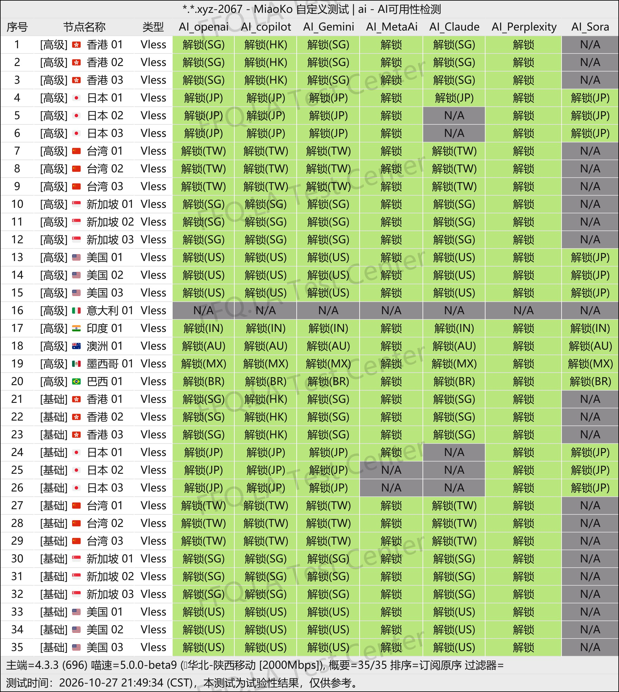
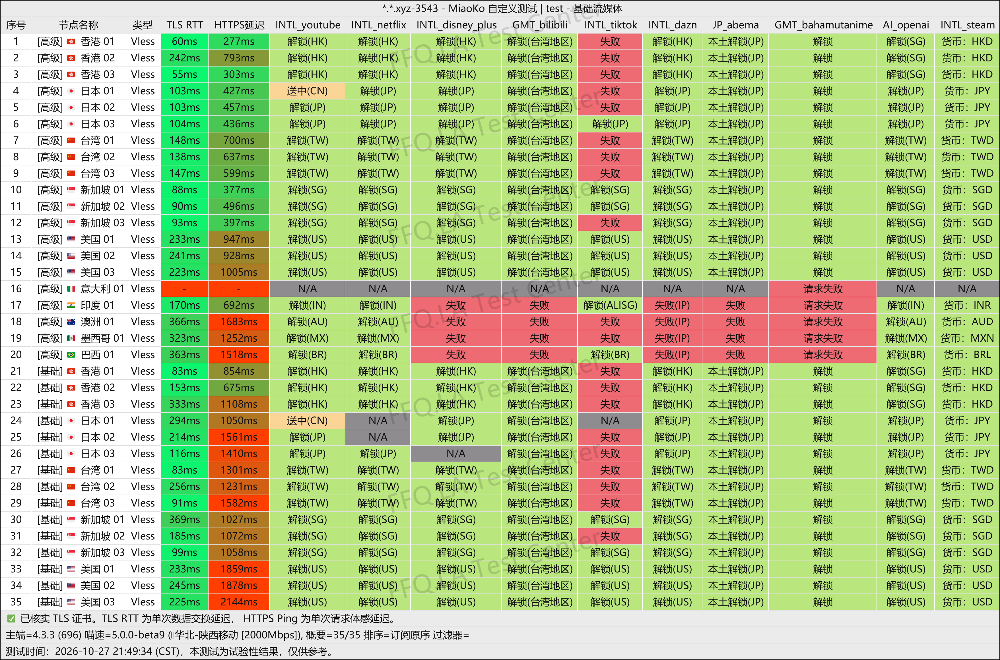
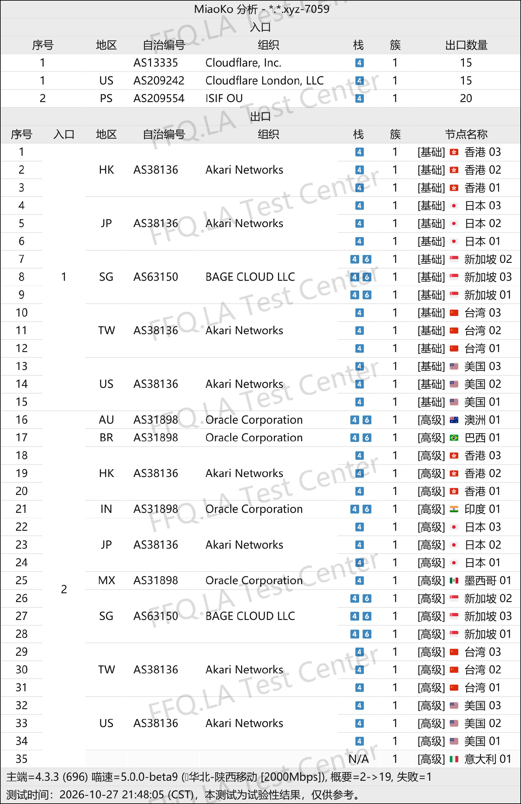

🇨🇳 [中文](README.md) | 🇺🇸 English | 🇷🇺 [Русский](README_RU.md) | 🇮🇷 [فارسی](README_FA.md)

# NowHere VPN Official Website (Updated November 11, 2026)

Official NowHere VPN Website<br>
Official URL: [dashboard.nowhere.best](https://to.iix.im/nw01)<br>

Best VPN Recommendations and Server List for 2026: [https://github.com/jdnei/JiChangTuiJian](https://github.com/jdnei/JiChangTuiJian)<br>

## Telegram VPN Deals & Community #AD
[VPN Giveaways](https://331024.de/archives/choujiang) | [VPN Chat Group](https://331024.de/archives/choujiang) | [VPN Trial Group](https://331024.de/archives/choujiang)<br>

[https://331024.de/archives/choujiang](https://331024.de/archives/choujiang)

## Invitation Code
```bash
WJQtOgAL
```

## Overview
NowHere VPN is a network acceleration service provider launched in 2026. It focuses on optimized international BGP routes and supports modern protocols such as VLESS and AnyTLS.

Its server network covers multiple regions, including Hong Kong, Japan, Taiwan, Singapore, the United States, and Europe.

NowHere offers affordable annual subscription plans and non-expiring data packages, making it suitable for everyday internet access, video streaming, file downloads, and backup VPN requirements.

## Advantages
NowHere VPN focuses on low prices and generous data allowances.

Its annual subscription plans start at just CNY 18 per year, providing 128 GB of data per month. A higher-tier annual plan costs CNY 32 per year and includes 512 GB of monthly data. Non-expiring data packages are also available.

All subscription plans provide access to both standard and premium servers, with support for up to five simultaneously connected devices.

Premium servers support experimental access-point switching, allowing users to adjust connection routes according to their internet service provider.

With more than 30 available servers, NowHere VPN offers a balance between affordability, flexibility, and everyday usability.

## Pricing Plans

| Plan | Data Allowance | Billing Cycle | Price | Speed Limit | Concurrent Devices | Server Access | Features / Notes |
| --- | --- | --- | --- | --- | --- | --- | --- |
| Origin · Basic Recurring Plan | 128 GB/month | Annual Subscription, Monthly Data Reset | ¥18/year | No Speed Cap | 5 Devices | Standard + Premium Servers | Multi-platform support; limited technical support; no refunds |
| Horizon · Advanced Recurring Plan | 512 GB/month | Annual Subscription, Monthly Data Reset | ¥32/year | No Speed Cap | 5 Devices | Standard + Premium Servers | Multi-platform support; limited technical support; no refunds |
| Mirage · Basic Data Package | 500 GB + 25% Bonus (625 GB Total) | One-Time Purchase, No Data Reset | ¥26 | No Speed Cap | 5 Devices | Standard + Premium Servers | Multi-platform support; limited technical support; no refunds |
| Ultra · Advanced Data Package | 1000 GB + 25% Bonus (1250 GB Total) | One-Time Purchase, No Data Reset | ¥52 | No Speed Cap | 5 Devices | Standard + Premium Servers | Multi-platform support; limited technical support; no refunds |
| Ultimate · Premium Data Package | 2000 GB + 25% Bonus (2500 GB Total) | One-Time Purchase, No Data Reset | ¥78 | No Speed Cap | 5 Devices | Standard + Premium Servers | Multi-platform support; limited technical support; no refunds |
| [Custom Plan](https://dashboard.nowhere.best/#/custom-plan) | Customizable | Recurring / One-Time | Based on Configuration | — | Customizable | — | Customize data allowance and concurrent device limits; view real-time pricing |

## 📊 Performance Tests & Analysis

#### 1.1 China Telecom Evening Peak-Hour Speed Test
<br>

#### 1.2 China Unicom Evening Peak-Hour Speed Test
<br>

#### 1.3 China Mobile Evening Peak-Hour Speed Test
<br>

#### 2.1 AI Service Unblocking Report
<br>

#### 2.2 Streaming Service Unblocking Report
<br>

#### 3. Entry and Exit Node Analysis
<br>
