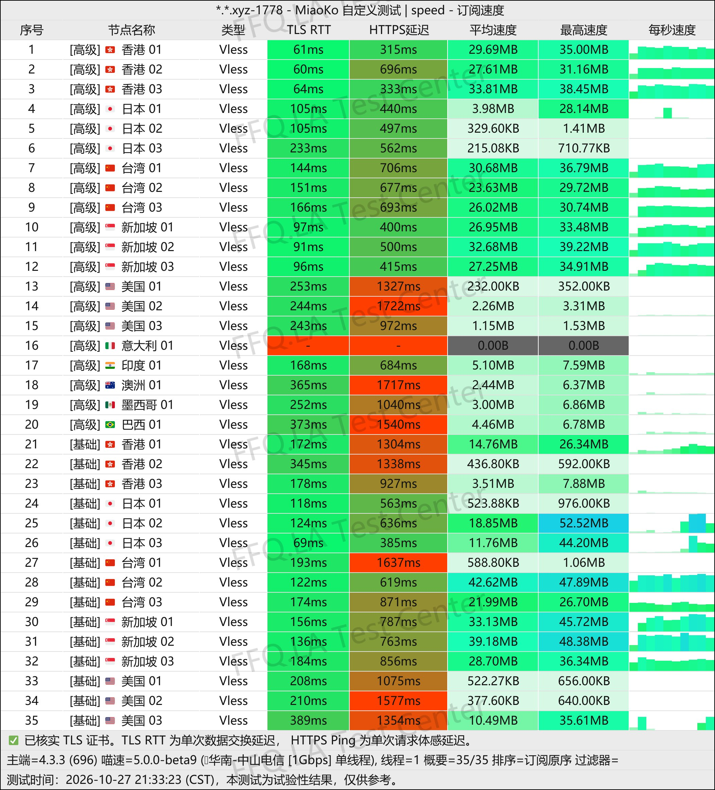
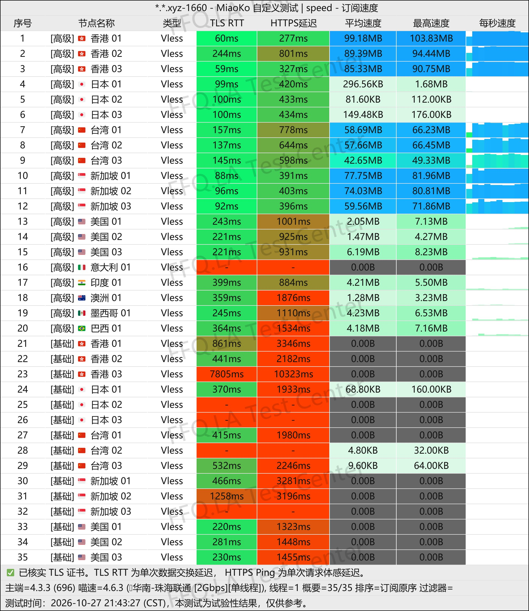
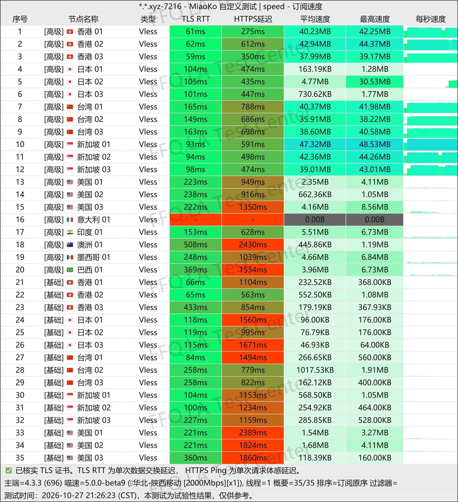
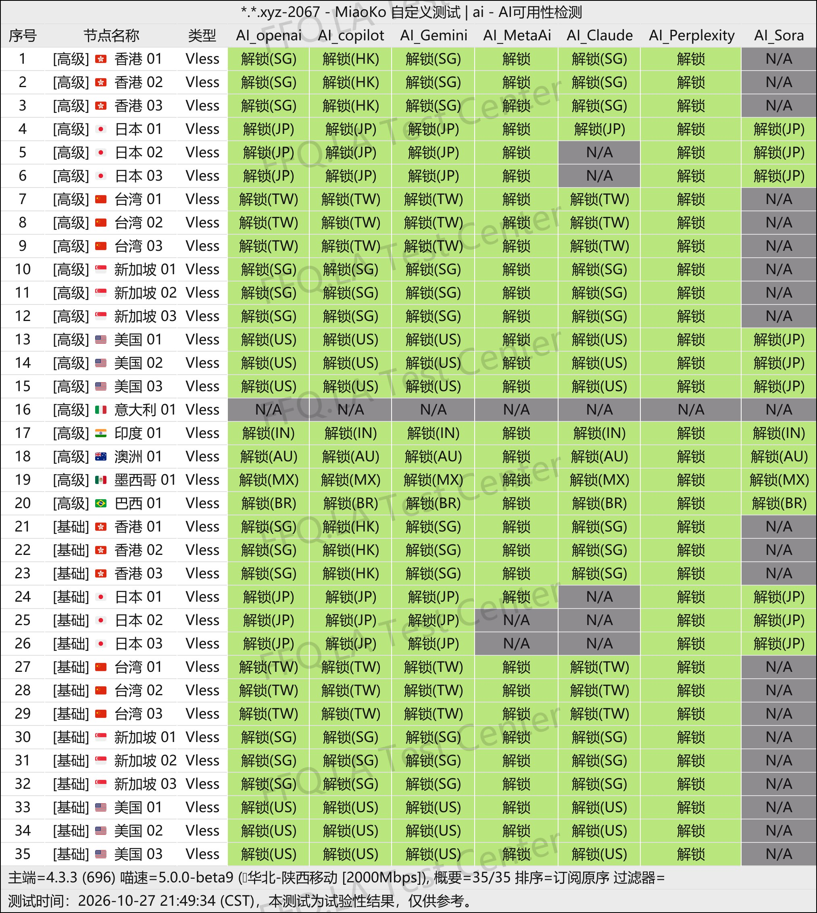
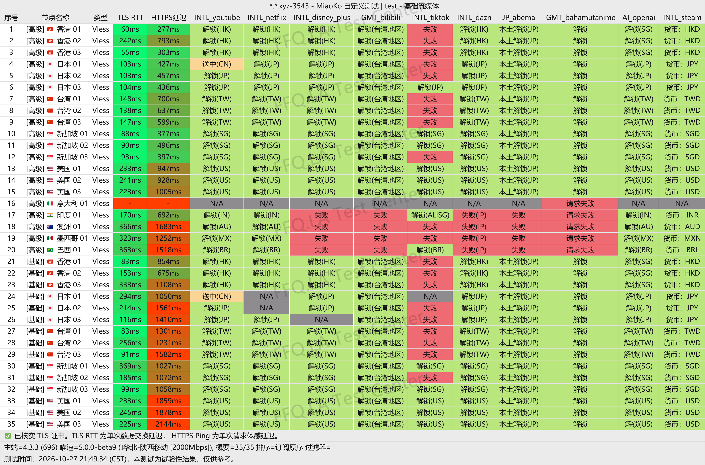
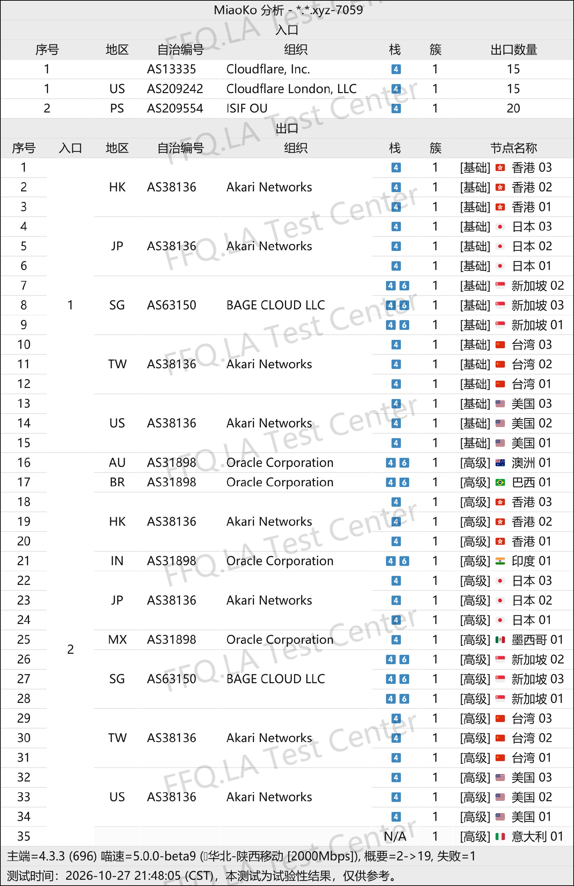

 🇨🇳 [中文](README.md) | 🇺🇸 [English](README_EN.md) | 🇷🇺 [Русский](README_RU.md) | 🇮🇷 فارسی

# وب‌سایت رسمی NowHere VPN (به‌روزرسانی ۱ نوامبر ۲۰۲۶)

وب‌سایت رسمی NowHere VPN<br>
آدرس رسمی: [dashboard.nowhere.best](https://to.iix.im/nw01)<br>

معرفی بهترین سرویس‌ها و سرورهای VPN در سال ۲۰۲۶: [https://github.com/jdnei/JiChangTuiJian](https://github.com/jdnei/JiChangTuiJian)<br>

## انجمن و پیشنهادهای ویژه VPN در تلگرام #AD
[قرعه‌کشی VPN](https://331024.de/archives/choujiang) | [گروه گفت‌وگوی VPN](https://331024.de/archives/choujiang) | [گروه آزمایش VPN](https://331024.de/archives/choujiang)<br>

[https://331024.de/archives/choujiang](https://331024.de/archives/choujiang)

## کد دعوت
```bash
WJQtOgAL
```

## معرفی
NowHere VPN یک ارائه‌دهنده خدمات افزایش سرعت شبکه است که در سال ۲۰۲۶ راه‌اندازی شد. این سرویس بر مسیرهای بین‌المللی BGP بهینه‌شده تمرکز دارد و از پروتکل‌های مدرن مانند VLESS و AnyTLS پشتیبانی می‌کند.

شبکه سرورهای آن مناطق مختلفی از جمله هنگ‌کنگ، ژاپن، تایوان، سنگاپور، ایالات متحده آمریکا و اروپا را پوشش می‌دهد.

NowHere طرح‌های اشتراک سالانه مقرون‌به‌صرفه و بسته‌های ترافیک بدون تاریخ انقضا ارائه می‌کند. این سرویس برای استفاده روزمره از اینترنت، تماشای ویدئوهای آنلاین، دانلود فایل و استفاده به‌عنوان VPN پشتیبان مناسب است.

## مزایا
NowHere VPN بر قیمت پایین و ارائه حجم بالای ترافیک تمرکز دارد.

طرح‌های اشتراک سالانه از تنها ۱۸ یوان چین در سال آغاز می‌شوند و ماهانه ۱۲۸ گیگابایت ترافیک ارائه می‌کنند. طرح سالانه پیشرفته‌تر با قیمت ۳۲ یوان در سال، ماهانه ۵۱۲ گیگابایت ترافیک در اختیار کاربران قرار می‌دهد. بسته‌های ترافیک بدون تاریخ انقضا نیز موجود هستند.

تمام طرح‌های اشتراک امکان دسترسی به سرورهای استاندارد و پیشرفته را فراهم می‌کنند و از اتصال هم‌زمان حداکثر پنج دستگاه پشتیبانی می‌کنند.

سرورهای پیشرفته از قابلیت آزمایشی تغییر نقطه دسترسی پشتیبانی می‌کنند که به کاربران امکان می‌دهد مسیر ارتباطی را متناسب با اپراتور اینترنت خود تنظیم کنند.

با بیش از ۳۰ سرور در دسترس، NowHere VPN تعادلی مناسب میان قیمت مقرون‌به‌صرفه، انعطاف‌پذیری و استفاده روزمره ارائه می‌دهد.

## طرح‌های اشتراک

| طرح | حجم ترافیک | دوره پرداخت | قیمت | محدودیت سرعت | دستگاه‌های هم‌زمان | دسترسی به سرورها | ویژگی‌ها / توضیحات |
| --- | --- | --- | --- | --- | --- | --- | --- |
| Origin · طرح پایه دوره‌ای | 128 GB/ماه | اشتراک سالانه، بازنشانی ماهانه حجم | ¥18/سال | بدون محدودیت سرعت | ۵ دستگاه | سرورهای استاندارد + پیشرفته | پشتیبانی از چندین پلتفرم؛ پشتیبانی فنی محدود؛ بدون بازپرداخت وجه |
| Horizon · طرح پیشرفته دوره‌ای | 512 GB/ماه | اشتراک سالانه، بازنشانی ماهانه حجم | ¥32/سال | بدون محدودیت سرعت | ۵ دستگاه | سرورهای استاندارد + پیشرفته | پشتیبانی از چندین پلتفرم؛ پشتیبانی فنی محدود؛ بدون بازپرداخت وجه |
| Mirage · بسته ترافیک پایه | 500 GB + ۲۵٪ هدیه (مجموع 625 GB) | خرید یک‌باره، بدون بازنشانی حجم | ¥26 | بدون محدودیت سرعت | ۵ دستگاه | سرورهای استاندارد + پیشرفته | پشتیبانی از چندین پلتفرم؛ پشتیبانی فنی محدود؛ بدون بازپرداخت وجه |
| Ultra · بسته ترافیک پیشرفته | 1000 GB + ۲۵٪ هدیه (مجموع 1250 GB) | خرید یک‌باره، بدون بازنشانی حجم | ¥52 | بدون محدودیت سرعت | ۵ دستگاه | سرورهای استاندارد + پیشرفته | پشتیبانی از چندین پلتفرم؛ پشتیبانی فنی محدود؛ بدون بازپرداخت وجه |
| Ultimate · بسته ترافیک ویژه | 2000 GB + ۲۵٪ هدیه (مجموع 2500 GB) | خرید یک‌باره، بدون بازنشانی حجم | ¥78 | بدون محدودیت سرعت | ۵ دستگاه | سرورهای استاندارد + پیشرفته | پشتیبانی از چندین پلتفرم؛ پشتیبانی فنی محدود؛ بدون بازپرداخت وجه |
| [طرح سفارشی](https://dashboard.nowhere.best/#/custom-plan) | قابل تنظیم | دوره‌ای / یک‌باره | بر اساس تنظیمات | — | قابل تنظیم | — | تنظیم آزاد حجم ترافیک و تعداد دستگاه‌های هم‌زمان؛ مشاهده قیمت به‌صورت لحظه‌ای |

## 📊 آزمایش عملکرد و تحلیل

#### 1.1 آزمایش سرعت China Telecom در ساعات اوج مصرف شبانه
<br>

#### 1.2 آزمایش سرعت China Unicom در ساعات اوج مصرف شبانه
<br>

#### 1.3 آزمایش سرعت China Mobile در ساعات اوج مصرف شبانه
<br>

#### 2.1 گزارش رفع محدودیت خدمات هوش مصنوعی
<br>

#### 2.2 گزارش رفع محدودیت سرویس‌های پخش آنلاین
<br>

#### 3. تحلیل سرورهای ورودی و خروجی
<br>
