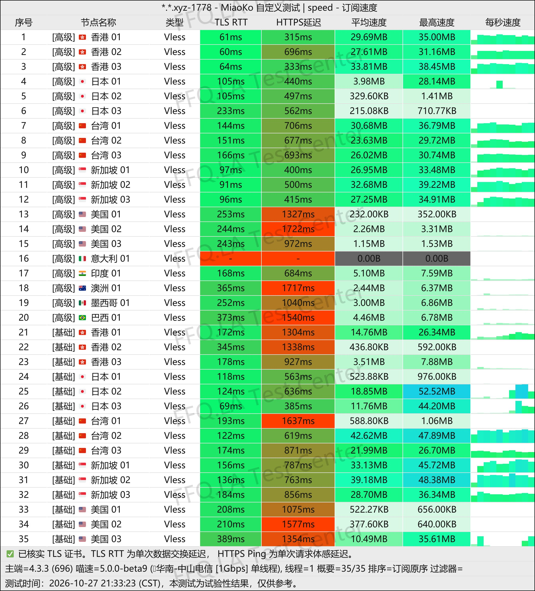
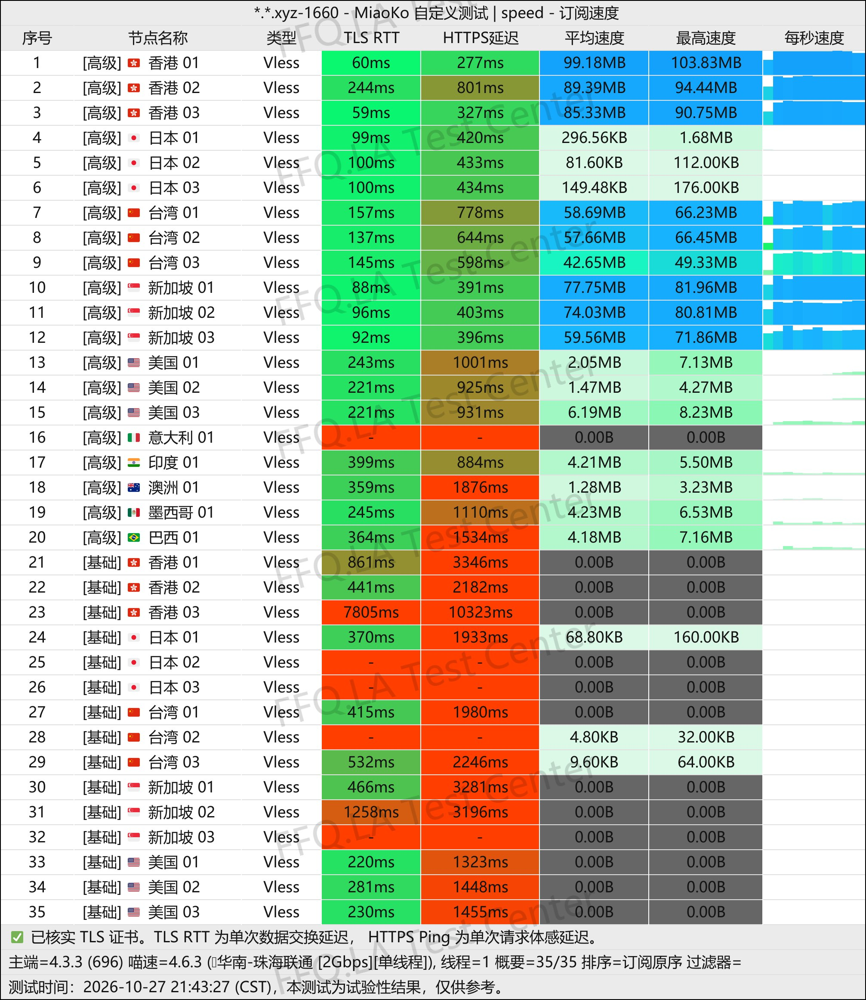
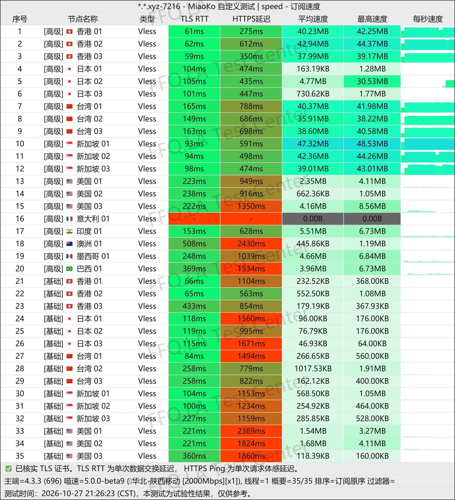
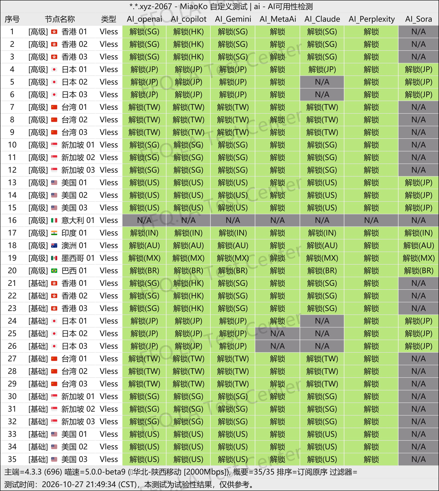
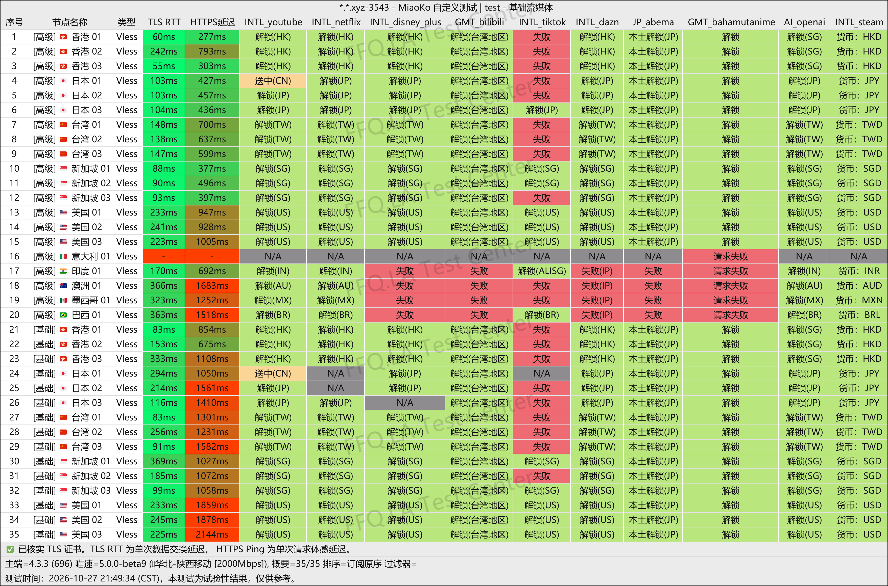
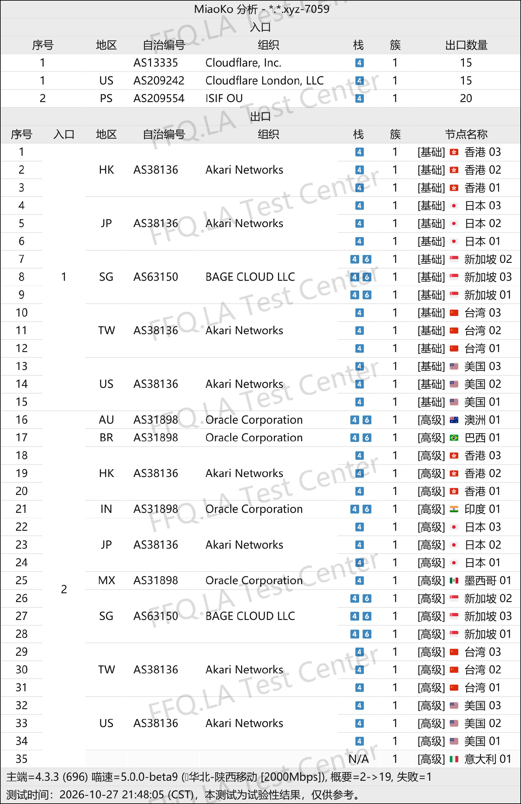

🇨🇳 [中文](README.md) | 🇺🇸 [English](README_EN.md) | 🇷🇺 Русский | 🇮🇷 [فارسی](README_FA.md)

# Официальный сайт NowHere VPN (обновлено 11 ноября 2026)

Официальный сайт NowHere VPN<br>
Официальный адрес: [dashboard.nowhere.best](https://to.iix.im/nw01)<br>

Лучшие VPN-сервисы и серверы на 2026 год: [https://github.com/jdnei/JiChangTuiJian](https://github.com/jdnei/JiChangTuiJian)<br>

## Telegram: VPN-сообщество и специальные предложения #AD
[Розыгрыши VPN](https://331024.de/archives/choujiang) | [Чат о VPN](https://331024.de/archives/choujiang) | [Группа тестирования VPN](https://331024.de/archives/choujiang)<br>

[https://331024.de/archives/choujiang](https://331024.de/archives/choujiang)

## Пригласительный код
```bash
WJQtOgAL
```

## Обзор
NowHere VPN — провайдер услуг ускорения сетевых соединений, запущенный в 2026 году. Сервис специализируется на оптимизированных международных маршрутах BGP и поддерживает современные протоколы, включая VLESS и AnyTLS.

Серверная сеть охватывает множество регионов, включая Гонконг, Японию, Тайвань, Сингапур, США и Европу.

NowHere предлагает доступные годовые подписки и пакеты трафика без срока действия. Сервис подходит для повседневного доступа в интернет, потокового видео, загрузки файлов и использования в качестве резервного VPN.

## Преимущества
NowHere VPN ориентирован на низкие цены и большие объёмы доступного трафика.

Годовые тарифы начинаются всего от 18 китайских юаней в год и предоставляют 128 ГБ трафика ежемесячно. Более продвинутый годовой тариф стоит 32 юаня в год и включает 512 ГБ трафика в месяц. Также доступны пакеты трафика без срока действия.

Все тарифные планы предоставляют доступ как к стандартным, так и к премиальным серверам, поддерживая до пяти одновременно подключённых устройств.

Премиальные серверы поддерживают экспериментальную функцию переключения точек доступа, позволяющую пользователям выбирать маршруты в зависимости от своего интернет-провайдера.

Благодаря более чем 30 доступным серверам NowHere VPN обеспечивает баланс между доступной ценой, гибкостью настроек и удобством повседневного использования.

## Тарифные планы

| Тариф | Трафик | Период оплаты | Цена | Ограничение скорости | Одновременные устройства | Доступные серверы | Особенности / Примечания |
| --- | --- | --- | --- | --- | --- | --- | --- |
| Origin · Базовый периодический тариф | 128 ГБ/мес. | Годовая подписка, ежемесячное обновление трафика | ¥18/год | Без ограничения скорости | 5 устройств | Стандартные + Премиальные серверы | Поддержка нескольких платформ; ограниченная техническая поддержка; возврат средств не предусмотрен |
| Horizon · Продвинутый периодический тариф | 512 ГБ/мес. | Годовая подписка, ежемесячное обновление трафика | ¥32/год | Без ограничения скорости | 5 устройств | Стандартные + Премиальные серверы | Поддержка нескольких платформ; ограниченная техническая поддержка; возврат средств не предусмотрен |
| Mirage · Базовый пакет трафика | 500 ГБ + 25% бонус (всего 625 ГБ) | Разовая покупка, без сброса трафика | ¥26 | Без ограничения скорости | 5 устройств | Стандартные + Премиальные серверы | Поддержка нескольких платформ; ограниченная техническая поддержка; возврат средств не предусмотрен |
| Ultra · Продвинутый пакет трафика | 1000 ГБ + 25% бонус (всего 1250 ГБ) | Разовая покупка, без сброса трафика | ¥52 | Без ограничения скорости | 5 устройств | Стандартные + Премиальные серверы | Поддержка нескольких платформ; ограниченная техническая поддержка; возврат средств не предусмотрен |
| Ultimate · Премиальный пакет трафика | 2000 ГБ + 25% бонус (всего 2500 ГБ) | Разовая покупка, без сброса трафика | ¥78 | Без ограничения скорости | 5 устройств | Стандартные + Премиальные серверы | Поддержка нескольких платформ; ограниченная техническая поддержка; возврат средств не предусмотрен |
| [Индивидуальный тариф](https://dashboard.nowhere.best/#/custom-plan) | Настраиваемый | Периодический / Разовый | Зависит от конфигурации | — | Настраиваемое количество | — | Свободная настройка объёма трафика и количества одновременных устройств; просмотр цены в реальном времени |

## 📊 Тесты производительности и анализ

#### 1.1 Тест скорости China Telecom в вечерние часы пик
<br>

#### 1.2 Тест скорости China Unicom в вечерние часы пик
<br>

#### 1.3 Тест скорости China Mobile в вечерние часы пик
<br>

#### 2.1 Отчёт о разблокировке AI-сервисов
<br>

#### 2.2 Отчёт о разблокировке стриминговых сервисов
<br>

#### 3. Анализ входных и выходных узлов
<br>
